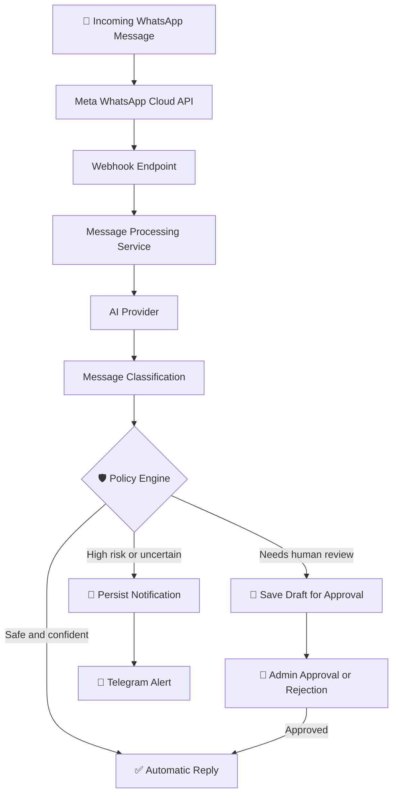

<div align="center">


### 🤖 A policy-controlled AI assistant for WhatsApp Business

*Receive, understand, prioritize, and respond to WhatsApp messages — with safety rules and human approval built into the workflow.*

<br />


<br />

[Overview](#-overview) •
[How It Works](#-how-it-works) •
[Features](#-core-features) •
[Tech Stack](#-technology-stack) •
[Getting Started](#-getting-started) •
[API](#-api-capabilities) •
[Roadmap](#-roadmap)

</div>

---

## 📖 Overview

**WhatsApp AI Personal Assistant** is a backend service that connects the **Meta WhatsApp Cloud API** with an **AI classification layer** and a **policy engine**.

It analyzes incoming messages and decides whether a message:

- ✅ can receive an **automatic response**,
- 📝 should be saved as a **draft for approval**, or
- 🚨 needs to trigger an **alert**.

> [!IMPORTANT]
> **The key principle is simple: AI suggests; the policy engine controls what the system is allowed to do.**

The project is built with **Node.js and TypeScript**. It does not use Python.

---

## ⚙️ How It Works



### 🧭 Message decision flow

| Situation | System behavior |
| :-- | :-- |
| ✅ **Safe + high confidence** | Sends an automatic reply |
| 📝 **Medium risk / needs review** | Saves a draft for human approval |
| 🚨 **High risk** | Blocks automatic sending and creates an alert |
| ❓ **Low confidence** | Does not auto-send; routes for review or alerting |

> [!NOTE]
> The policy engine is the **safety-critical layer**. An AI classification alone cannot override the configured safety rules.

---

## ✨ Core Features

| | Feature | Description |
| :-: | :-- | :-- |
| 💬 | **WhatsApp Cloud API integration** | Verifies webhooks, parses incoming events, and sends messages |
| 🔌 | **Swappable AI provider** | Uses an OpenAI-compatible API adapter instead of coupling the app to one provider |
| 🧠 | **Structured AI classification** | Validates classification output against a schema |
| 🛡️ | **Policy-controlled replies** | Applies risk and confidence rules before any automatic response |
| 👤 | **Human approval workflow** | Approve or reject response drafts |
| 📲 | **Telegram notifications** | Sends alerts for messages that need attention |
| 💾 | **Persistent notifications** | Stored before delivery, so a Telegram failure never silently erases an alert |
| 📚 | **Knowledge base loader** | Loads JSON knowledge files with deterministic pattern matching |
| 🔧 | **Runtime AI settings** | Read and update the AI provider/model without restarting the app |
| 🔁 | **Retry with backoff** | Retries outbound HTTP operations with backoff |
| ⏱️ | **Rate limiting** | Request limits on public webhook and admin API routes |
| ♻️ | **Idempotent processing** | Integration coverage for duplicate-message handling |
| 🐳 | **Docker support** | Dockerfile and Docker Compose config for local PostgreSQL development |

---

## 🧰 Technology Stack

<table>
  <tr>
    <td valign="top" width="33%">

**🟢 Runtime & Language**
- Node.js 20+
- TypeScript 5.6
- `tsx`

**🌐 Backend & API**
- Express.js 4
- REST API
- Meta WhatsApp Cloud API
- Telegram Bot API

    </td>
    <td valign="top" width="33%">

**🤖 AI Integration**
- OpenAI-compatible API
- Configurable provider and model
- Zod-validated classification output

**🗄️ Database & ORM**
- PostgreSQL
- Prisma 5
- `@prisma/client`

    </td>
    <td valign="top" width="33%">

**🔐 Validation, Logging & Security**
- Zod
- Pino + Pino HTTP
- `express-rate-limit`
- dotenv

**🧪 Testing & Code Quality**
- Vitest
- Supertest
- ESLint
- Prettier

    </td>
  </tr>
</table>

**🐳 Development & Infrastructure:** pnpm • Docker • Docker Compose • TypeScript Compiler (`tsc`)

---

## 🏗️ Architecture Notes

The application uses **provider interfaces** to keep external integrations replaceable:

| Interface | Responsibility |
| :-- | :-- |
| `AiProvider` | Abstracts the AI classification provider |
| `WhatsAppProvider` | Abstracts WhatsApp messaging operations |
| `NotificationProvider` | Abstracts notification delivery |

This separation keeps the message-processing and policy logic independent from individual third-party services.

---

## 📁 Project Structure

```text
whatsapp-ai-assistant/
├── prisma/                 # Prisma schema and migrations
├── src/
│   ├── config/             # Environment and application configuration
│   ├── knowledge/          # JSON knowledge base files
│   ├── services/           # Message processing and application services
│   ├── types/              # Provider interfaces and shared types
│   ├── utils/              # Shared utilities, including retry logic
│   └── server.ts           # Application entry point
├── tests/                  # Unit and integration tests
├── .env.example            # Environment variable template
├── Dockerfile
├── docker-compose.yml
├── package.json
├── pnpm-lock.yaml
├── tsconfig.json
└── vitest.config.ts
```

---

## 🚀 Getting Started

### 📋 Prerequisites

- Node.js **20** or later
- **pnpm**
- PostgreSQL (or Docker)
- Meta WhatsApp Cloud API credentials
- An API key for an OpenAI-compatible AI provider
- Telegram Bot credentials (if Telegram notifications are enabled)

### 1️⃣ Clone the repository

```bash
git clone https://github.com/Robinishear/whatsapp-ai-assistant.git
cd whatsapp-ai-assistant
```

### 2️⃣ Install dependencies

```bash
pnpm install
```

### 3️⃣ Configure environment variables

```bash
cp .env.example .env
```

Update `.env` with your local database URL and provider credentials.

<details>
<summary><b>🔑 Click to view all environment variables</b></summary>

<br />

| Variable | Purpose |
| :-- | :-- |
| `NODE_ENV` | Application environment |
| `PORT` | HTTP server port |
| `DATABASE_URL` | PostgreSQL connection string |
| `WHATSAPP_ACCESS_TOKEN` | Meta WhatsApp access token |
| `WHATSAPP_PHONE_NUMBER_ID` | WhatsApp phone number ID |
| `WHATSAPP_VERIFY_TOKEN` | Webhook verification token |
| `AI_PROVIDER` | AI provider identifier |
| `AI_MODEL` | AI model name |
| `AI_BASE_URL` | OpenAI-compatible API base URL |
| `AI_API_KEY` | AI provider API key |
| `NOTIFICATION_PROVIDER` | Notification provider |
| `NOTIFICATION_BOT_TOKEN` | Telegram bot token |
| `NOTIFICATION_CHAT_ID` | Telegram destination chat ID |

</details>

> [!WARNING]
> Never commit your real `.env` file or API credentials.

### 4️⃣ Run database migrations

```bash
pnpm prisma:migrate
```

### 5️⃣ Start the development server

```bash
pnpm dev
```

The server listens on **`http://localhost:5000`** by default. The port can be changed through the `PORT` environment variable.

---

## 🧾 Available Scripts

| Command | Description |
| :-- | :-- |
| `pnpm dev` | Start the development server with watch mode |
| `pnpm build` | Compile TypeScript and copy knowledge JSON files |
| `pnpm start` | Run the compiled server |
| `pnpm lint` | Lint TypeScript source files |
| `pnpm format` | Format TypeScript source files |
| `pnpm test` | Run the test suite |
| `pnpm test:watch` | Run Vitest in watch mode |
| `pnpm prisma:generate` | Generate Prisma Client |
| `pnpm prisma:migrate` | Run Prisma development migrations |

---

## 🔗 API Capabilities

The current implementation includes endpoints for:

- ❤️ Health checks
- 📩 WhatsApp webhook verification and message reception
- 💬 Conversation retrieval
- ✅ Approving and rejecting response drafts
- ⚙️ Reading and updating AI provider/model settings
- 🔔 Retrieving persisted notifications

| Method | Endpoint | Purpose |
| :-: | :-- | :-- |
| `GET` | `/api/settings/ai` | Read the current AI provider/model settings |
| `PATCH` | `/api/settings/ai` | Update AI provider/model settings at runtime |
| `GET` | `/api/notifications` | Retrieve persisted notifications |

> See the source code for the exact request and response schemas.

---

## 🧪 Testing

```bash
pnpm test
```

The repository includes **policy-engine unit tests** and **webhook-flow integration tests**. The integration tests cover:

- ✅ Automatic replies
- 🚨 High-risk policy overrides
- 📝 Medium-risk drafts
- ♻️ Idempotency
- 📲 Notification delivery failures

> [!NOTE]
> External providers and the database are mocked in these tests; they do not replace a live WhatsApp end-to-end test.

---

## 📊 Current Development Status

<table>
  <tr>
    <td valign="top" width="50%">

### ✅ Implemented

- [x] Core TypeScript/Express application scaffold
- [x] Provider interfaces and integration adapters
- [x] WhatsApp webhook verification, parsing, and sending
- [x] AI classification adapter
- [x] Policy engine and message-processing pipeline
- [x] Telegram notification integration
- [x] Prisma data model
- [x] Core REST endpoints
- [x] Rate limiting and retry utility
- [x] Docker configuration
- [x] Unit and integration tests for key flows

    </td>
    <td valign="top" width="50%">

### 🚧 Still to complete

- [ ] Replace the placeholder admin bearer-token guard with proper authentication before broader or multi-user use
- [ ] End-to-end test with real Meta WhatsApp credentials and a WhatsApp test number
- [ ] Expand the JSON knowledge base with `faq.json`, `services.json`, and `style-guide.json` (currently only `response-rules.json` has content)

    </td>
  </tr>
</table>

---

## 🔒 Security Notes

- 🔑 Keep secrets in environment variables.
- 🚫 Never commit `.env`.
- 🛡️ Keep the admin API protected — the current bearer-token guard is a **placeholder**, not production-grade multi-user authentication.
- ⛔ Do not allow AI output to bypass the policy engine.
- 📘 Verify the latest Meta WhatsApp Cloud API documentation before production deployment, because API behavior and requirements may change.

---

## 🗺️ Roadmap

- [ ] Implement production-ready admin authentication
- [ ] Complete live WhatsApp Cloud API end-to-end testing
- [ ] Expand the JSON knowledge base
- [ ] Review deployment configuration and production observability
- [ ] Add further tests for edge cases and failure recovery

---

## 🤝 Contributing

Contributions, ideas, and bug reports are welcome. Please open an issue to discuss significant changes before submitting a pull request.

---

## 📄 License

No license has been specified yet. All rights are reserved unless a license is added to this repository.

---

<div align="center">

### 👨‍💻 Author

**[@Robinishear](https://github.com/Robinishear)**

⭐ If you find this project useful, consider giving it a star!

**Built with Node.js, TypeScript, and a safety-first approach to AI automation.**

</div>
